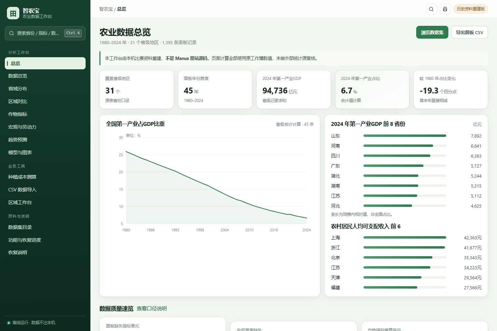

# 智农宝 · 农业数据工作台 v2.2.0（安装包 + 全量源码）

**一句话**：把本机比赛资料里的农业数据做成一个可安装的 Windows 桌面应用 —— 双击 exe 即可安装，装完从桌面打开，浏览器里看到完整的数据分析工作台；全部源码、数据、打包脚本也在包内，任何一台装了 Python 的机器都能重新构建。

---

## 1. 包内有什么

| 路径 | 内容 |
| --- | --- |
| `dist/智农宝_安装程序_v2.2.0.exe` | **主交付物**。单文件安装器 + 运行器，内置全部站点资源与数据 |
| `dist/exe.sha256` | exe 的 SHA-256 校验值 |
| `site/` | 网站完整源码（HTML / CSS / 原生 JS / 数据 JSON / 24 张分析图 / 模型脚本） |
| `desktop/` | 桌面启动器与安装器源码（Python）+ PyInstaller 配置 + 图标 |
| `tools/` | 构建与验收脚本（数据打包、exe 打包、图标生成、自动化测试） |
| `docs/` | 安装使用说明、功能与数据说明、二次开发说明、界面截图 |
| `start_dev.bat` | 有 Python 环境时，从源码直接启动（不安装） |

## 2. 三步用起来

1. 双击 `dist/智农宝_安装程序_v2.2.0.exe`；
2. 弹窗问"要把智农宝安装到本机吗" → 选 **是**；
3. 安装完成后浏览器自动打开工作台；以后从桌面或开始菜单的「智农宝」直接进入。

不想安装也可以选 **否**，程序会以便携模式只运行这一次，不改动系统任何位置。
卸载：`设置 → 应用 → 智农宝（农业数据工作台）→ 卸载`，或运行安装目录下的卸载命令。

> 详细步骤、常见问题见 [`docs/安装与使用说明.md`](docs/安装与使用说明.md)。

## 3. 网站里能做什么（21 个页面）

| 页面 | 能力 |
| --- | --- |
| 总览 | 全新 Hero 横幅 + 5 个关键指标卡、全国一产占比 45 年趋势、Top 榜单、数据质量速览 |
| 数据总览 | 年份切换、大区多选筛选、省份搜索、点表头排序、分页、合计行、CSV 导出、复制为表格 |
| 省域分布 | 7 种指标切换、年份滑块、31 省矩阵热力（不使用行政边界，规避边界合规问题）、点击下钻 |
| 区域对比 | 最多 4 省同图对比、与全国均值差、首末变化、年均复合增长率 |
| 省份详情 | 单省多指标趋势、同指标全国排名、6 张迷你走势、单省 CSV 导出 |
| 作物指标 | 31 省 × 30 类播种面积指标、最多 4 省叠加、**2022 年及以后色带标注"可能含推算"** |
| 宏观与劳动力 | 12 个宏观指标任选 4 个叠加、缺失值保留、宽表逐行浏览 |
| 趋势预测 | 本地最小二乘 / 指数外推，给出 R²、斜率、外推值；**越界（<0 或 >100%）会给出警告** |
| 模型与图表 | 24 张原项目分析图，按 A/B/C/D/E 分组检索，灯箱放大与下载原图 |
| 数据集目录 | 125 份去重工作簿、搜索/分组过滤、逐表预览、行内检索、CSV 与原始 JSON 下载 |
| 种植成本测算 | 8 项输入、成本结构、保本单价、单价 ±30% 敏感性表、明细导出 |
| CSV 导入 | 本地解析、列类型识别与统计、预览、导出解析结果（不上传任何数据） |
| 区域工作台 | 按东部/中部/西部/东北下钻，指标切换，省份明细 |
| 项目与答辩 | 硕士毕设汇报结构：研究背景 / 目标 / 技术路线 / 系统架构 / 成果 / 创新点 / 展望 |
| 数据备份与恢复 | 备份恢复时间线、操作步骤、常见问题 FAQ、上传演示 |
| 种植防亏损决策 | 保本价、预期利润、风险评级（绿/黄/红）、AI 种植建议与敏感性矩阵 |
| 产量与价格预测 | 作物单产/价格参考序列的趋势外推与 AI 解读（演示算法） |
| 数字农田生态 | 四情监测、气象、土壤墒情、长势分区、农事任务与设备状态一屏总览 |
| 功能与恢复进度 | 明确区分"已重建 / 历史成果 / 仍未恢复"三类 |
| 恢复说明 | 数据口径、校验方式、安装信息、版本与边界 |
| 全局命令面板 | `Ctrl + K` 搜索省份、指标、工作簿、图表、页面 |

键盘与输出：`Ctrl+K` 搜索、`Esc` 关闭浮层、表头点击排序、右上角打印按钮可直接打印或另存 PDF（已写打印样式）。



## 4. 数据规模与口径

| 项 | 数值 |
| --- | --- |
| 省级面板记录 | 1,395 条（31 省 × 45 年，1980–2024） |
| 面板字段 | 9 列（GDP、人均 GDP、第一产业 GDP、占比、人口、农村收入、一产收入估算等） |
| 去重可解析工作簿 | 125 份，含 300+ 张工作表 |
| 原始文件记录 | 232 份（含重复版本），逐份 SHA-256 |
| 作物指标 | 31 省 × 30 类 "千公顷" 序列 |
| 分析图 | 24 张（A/B/C/D/E 五组） |

口径原则写在页面里，也写在这里：
- 占比类指标一律"合计值 ÷ 合计值"，不是各省百分比求平均；
- 人均类指标用"GDP 合计 ÷ 人口合计"；
- 空值保留，不插补；
- 作物指标 2022 年及以后可能由增长率补齐，`彩色带 + 「可能含推算」` 标注，不当作官方实测；
- 趋势预测是**浏览器内现算的演示算法**，不是比赛项目的 SARIMA / 分类模型输出。

## 5. 这不是 Manus 原站源码

必须说清楚：原站 `agriviz-frtuykrx.manus.space` 已下线，本机只找到它的访问记录、路由清单与农业工作簿，**没有**找到其前后端工程、数据库、账号体系和实时行情接口。所以本项目是"有证据支撑的功能重建"，不是原站逐字节还原。没有恢复的功能（行情预警、AI 助手、账号后台、政策库、国际对比）在「功能与恢复进度」页里全部标为未恢复，不做假接口。

## 6. 从源码重新构建

```bash
# 1) 重建站点核心数据包（把 site/data/*.json 打成 core-data.js）
python tools/build_core_data.py

# 2) 打包 exe（需要 Python 3.9+ 与 pyinstaller）
pip install -r requirements-dev.txt
python tools/build_exe.py

# 3) 不打包，直接跑源码版
python desktop/zhinongbao.py --no-browser --port 8765
```

自动化验收（需要 Node 18+ 与本机 Edge 浏览器）：

```bash
node tools/smoke_test.mjs      # 21 个路由 + 21 项交互断言，输出到 outputs/qa/
node tools/file_protocol_check.mjs   # 验证双击 index.html 的降级能力
```

本次交付前已跑通：21/21 路由通过、21/21 交互通过、控制台 0 错误；安装 → 快捷方式 → 注册表 → 卸载 → 重装全流程实测通过。

## 7. 校验

```
exe  SHA-256  a51ea4aa1111be53ca52a6e98f6972f26504703ae52dc26925abc8d710d36fe8
     体积     18,662,217 字节（17.8 MB）
```

> 分发提示：包内含比赛工作簿与对话恢复文档，对外分享前请自行确认数据授权范围；`site/data/source_files/` 与 `site/data/tables/` 是原始数据本体，如需脱敏可整目录剔除后用 `python tools/build_core_data.py` 重建。
